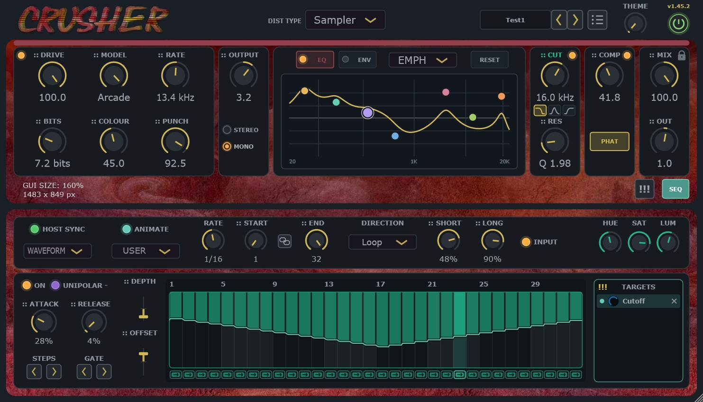
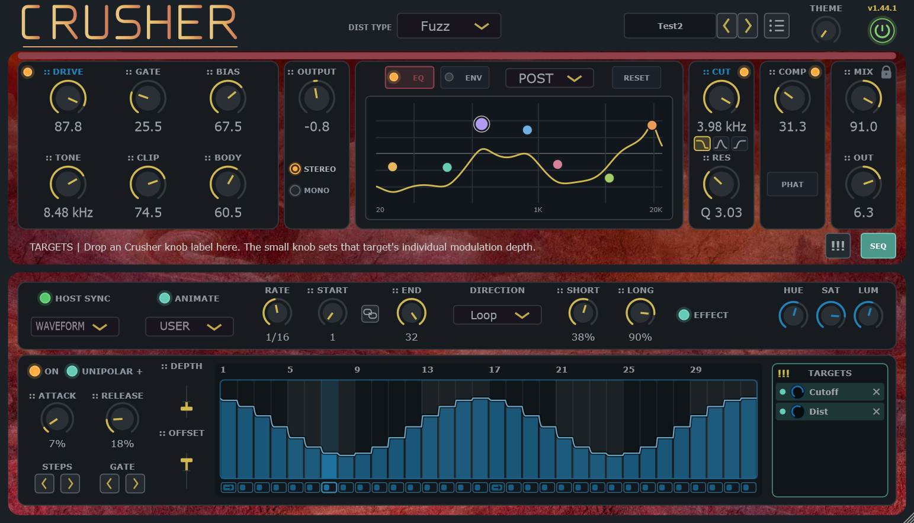

# Crusher

# Introduction

**Crusher v1.40.0** is a Windows x64 VST3 distortion plugin by Dead Channel Audio. It combines 19 selectable distortion algorithms, a seven-band graphical EQ, the HumpCrusher filter and compressor, and a 32-step modulation sequencer. The original HumpCrusher MECH/TUBE signal path is selectable as **Hump**, with optional neutral-by-default enhancements. The original HumpDSP source is kept intact.

Crusher is in active development. Earlier development presets and automation mappings are intentionally not supported when parameters are redesigned.

## Signal flow and panel controls

The interface panels run from left to right: **DISTORTION → OUTPUT/MODE → EQ → FILTER → COMP → MIX/OUT**. The OUTPUT/MODE panel is the same 66-pixel width as FILTER, COMP and MIX/OUT. All six top-level effect panels retain uniform 6-pixel gaps (matching the sequencer panel divider). The DISTORTION panel is 264 pixels wide and the EQ panel is 332 pixels wide. MIX/OUT remains in its original position.

- **EQ:** Shared seven-band graphical EQ with PRE, EMPH (emphasis plus complementary post-EQ) and POST modes. Seven draggable points span low bass to high treble. Toggle its amber LED to bypass. Drag points to set frequency and gain; use the mouse wheel to adjust bandwidth/Q, right-click for filter shape, and use FLAT to reset all seven bands.
- **DISTORTION:** Select one of 19 types from the alphabetical menu. Its amber LED bypasses the selected distortion; knobs change contextually. Six-knob types use an evenly spaced **3 × 2** grid (81-pixel columns), with TONE directly below DRIVE; Hump places TONE below its first control, MECH. Asym uses five knobs, with TONE below DRIVE. Amp uses DRIVE, SOFT CLIP and TOP BOOST above its smaller CAB dropdown and BIAS. The CAB dropdown is **120 × 20 pixels**, with the same proportions as before and the same height as the sequencer dropdowns.
- **OUTPUT:** Shared **±12 dB distortion-wet level**, neutral at **0 dB**. It is *not* the final master OUT. It is processed after the Hump filter/TUBE stages (where used) and before the EQ's post stage and compressor. The knob can be dragged to a sequencer target.
- **STEREO/MONO:** Shared *pre-distortion input* selector, default **STEREO**. STEREO keeps the original independent left/right inputs. MONO averages the two input channels before the selected distortion (after any pre-EQ). This can change the distortion character because nonlinear waveshaping reacts differently to the sum. For Amp, MONO retains the pre-distortion summing behaviour of the previous Amp selector. Mono input does **not** promise identical stereo output: effects with internal stereo offsets or independent state, notably Comb, may generate differences later in the path.
- **FILTER:** The original HumpCrusher resonant filter, with CUT and RES, and a separate amber power LED. Its algorithm is unchanged.
- **COMP:** Original HumpCrusher compressor with COMP and PHAT, plus an amber power LED. Its DSP is unchanged.
- **MIX / OUT:** The pre-existing final dry/wet MIX and master OUT remain unchanged. Output trim in the new shared panel changes only the wet effect path; final OUT changes the mixed signal.

At **STEREO** and **distortion OUTPUT 0 dB**, the new signal path preserves the previous processing response at otherwise unchanged settings. The individual distortion-type OUTPUT knobs/parameters have been removed; the model DSP's neutral unity-gain paths are retained internally for accurate neutral sound. All other model-specific control defaults remain unchanged.

## Distortion types

| Type | Contextual controls (shared OUTPUT and input MODE are in their own panel) |
|---|---|
| Amp | DRIVE, SOFT CLIP, TOP BOOST, BIAS; CAB dropdown with 16 modelled cabinet choices |
| Asym | DRIVE, BIAS, SKEW, SHAPE, TONE |
| Bumpy | DRIVE, RIPPLE, RATE, CONTOUR, BIAS, TONE |
| Comb | DRIVE, TIME, FEEDBACK, DAMP, SPREAD, TONE |
| Crackle | DRIVE, DENSITY, BURST, DECAY, GRIT, TONE |
| Diode Clip | DRIVE, DIODE, ENV / IN HP, OUT HP, OUT LP |
| Fresh | DRIVE, FREQ, EXCITE, AIR, SAT, TONE |
| Fuzz | DRIVE, GATE, BIAS, CLIP, BODY, TONE |
| Hard Clip | DRIVE, THRESH, BIAS, KNEE, FOLD, TONE |
| Hump | MECH, TUBE, BODY, BIAS, FOLD, TONE |
| Lightning | DRIVE, SPARK, REACT, CLIP, EDGE, TONE |
| Pixelated | DRIVE, RATE, BITS, DITHER, JITTER, TONE |
| Razor | DRIVE, EDGE, FREQ, RING, BITE, TONE |
| Rectify | DRIVE, WAVE, BIAS, CURVE, FOLD, TONE |
| Samurai | DRIVE, EDGE, GATE, BLADE, RING, TONE |
| Saturation | DRIVE, CURVE, BIAS, WARM, BODY, TONE |
| Soft Clip | DRIVE, THRESH, KNEE, BIAS, BODY, TONE |
| Stressed | DRIVE, PRESS, FOLD, TENSION, BIAS, TONE |
| Tube | DRIVE, BIAS, HEAT, SAG, BODY, TONE |

Diode Clip is an independently implemented, diode-inspired distortion: IN HP shapes the input before clipping, ENV changes the speed of the transient-following clipping threshold (a subtle effect on sustained sounds), DIODE changes the asymmetric transfer curve, and OUT HP / OUT LP shape the output. These are not AIR Music Technology algorithms or modelled copies. The five Diode Clip controls are automatable and draggable to sequencer targets.

Each existing model's original sound remains available at its neutral control settings. The independently developed Amp cabinet models use original filter/resonance responses, not AIR proprietary code or impulse responses. Hump's optional BODY/BIAS/TONE are neutral at 50%, FOLD at 0%; the upstream Mech/Tube DSP remains byte-for-byte unchanged.

## THEME and optional background artwork

- The horizontal colour strip is fixed to the same **muted distortion red (#8e414b)** used by THEME at 100%, regardless of distortion type. THEME is bipolar: **0%** shows the full background graphic, **50%** is plain charcoal (no graphic), and **100%** is solid muted distortion red. Positions between the endpoints fade continuously; double-click THEME to return to 50%.
- To use custom artwork, place a JPEG named **`crusher_background.jpg`** in `_Projects\Crusher\Resources` beside your existing `logo.svg`, then rebuild by double-clicking `- Build.bat`. The image is optional; if missing, the plugin still builds and the left half of THEME uses plain charcoal. The selected image is embedded into the VST3 at build time, so changing the JPG requires another build.
- The artwork appears **only in the coloured surround** behind the main effect controls and sequencer. The dark control panels remain opaque, and the gap between the two sections is never covered. One image coordinate system spans both sections; a roughly **910 × 470** pixel artwork suits the reference layout (other image sizes are proportionally cropped to fill).
- The development source ZIP deliberately excludes the entire `Resources` folder. Keep your own logo, background and screenshots in place. Do not rename the required JPEG.

## Sequencer and presets

- Expand the 32-step sequencer with the SEQ control. It retains 16 modulated parameter-target slots, drag-to-target assignment, Gate controls and host-sync options.
- Drag the name of a contextual control, the shared distortion OUTPUT label, or an existing supported parameter label to a target slot. The shared STEREO/MONO choice is host-automatable but is not a sequencer target.
- **EQ sequencer assignment:** Right-click any of the seven coloured EQ points. Select **Set Seq Target Gain** to modulate the point's **gain (up/down, dB)**, or **Set Seq Target Freq** to modulate its **frequency (left/right, Hz)**. Either direction adds or re-enables that parameter in the first available of the existing **16 target slots**. Both directions can be assigned independently, and each uses the usual target-depth control. If all slots are occupied, free a slot in the sequencer first. The other right-click options still change the point's filter shape.
- When an assigned EQ point is sequenced, its displayed position and response curve animate without overwriting the saved EQ parameters. The EQ section must be switched on to hear the modulation; PRE/EMPH/POST, wheel-adjusted Q, FLAT and manual point-dragging are unchanged. EQ parameter modulation is evaluated once per audio block, with the existing coefficient smoothing preventing abrupt filter jumps; extremely fast movement is limited by host buffer size.
- There is no processing of all 19 distortion engines simultaneously. Only the selected engine, plus a brief outgoing model during a type change, runs.
- Presets and sequences can be saved to the plugin's portable data folder. Earlier development presets and stored target assignments are intentionally incompatible because model-specific OUTPUT parameters were removed and target IDs compacted. Existing `.crusherseq` files contain only step values and gates (not target choices), so those sequence patterns can still be loaded.

## Identity and storage

- Project/output: `Crusher`, VST3 binary `Crusher.vst3`
- Version: `1.40.0`; manufacturer `sl23`; plugin code `cru1`; bundle ID `com.sl23.crusher`
- State root: `CrusherParameters`, schema version **3**
- Presets: `.crusherpreset`; sequences: `.crusherseq` (`CrusherSequence` state root)
- Portable data: **`Crusher_Data`** beside the installed VST3 when needed; the build does not create this directory.

## Requirements and build instructions

- Windows x64 and a 64-bit VST3 host.
- Visual Studio Community 2026 x64, shared CMake at `_Tools\cmake\_4.4.2` and JUCE 9.0.4 at `_Tools\JUCE\_9.0.4`.
- A writable VST3/data location for portable settings and presets.

1. Extract the `Crusher` folder into `_Projects` beside `_Tools`, giving `_Projects\Crusher`.
2. **Keep your own `Resources` folder.** This development source ZIP deliberately excludes Resources. Make sure `_Projects\Crusher\Resources\logo.svg` exists. Screenshots and `crusher_background.jpg` are optional at build time.
3. Double-click `_Projects\Crusher\- Build.bat`.
4. Check `Results.log` for PASS/FAIL. The compiled portable Windows VST3 binary is `_Projects\Crusher\dist\Crusher.vst3`; the script does not install the plugin.

## Validation in your DAW

1. Select Amp, leave OUTPUT at **0 dB** and mode at **STEREO**; verify the original stereo result. Set **MONO**, feed different material to left and right, and check that the distorted wet signal changes. Check the CAB selection remains Amp-only.
2. Change to Hump, set optional controls neutral, and confirm original MECH/TUBE, FILTER and COMP behaviour. The original filter/compressor source is not modified.
3. Switch between several distortion types and verify their contextual knobs appear without shifting; check no hidden model's DSP continues running outside the short crossfade.
4. Turn shared distortion OUTPUT up/down and confirm it changes wet level without moving the final MIX/OUT knob. Verify the sequencer can modulate shared OUTPUT.
5. Check the 32 sequencer steps, all five Diode Clip targets, and the 14 EQ X/Y targets. Assign EQ 1 Gain and Frequency separately, set individual target depths, enable EQ, and confirm the EQ points animate and the sound changes. Check zoom menu sizing at 75%, 100%, 150% and 200%, amber LEDs, section dimming and preset browser. Compare a clean stereo file with the earlier version using **STEREO**, OUTPUT 0 dB and other controls unchanged.

**Development status:** Source checks and standalone DSP compilation do not replace full Windows JUCE/VST3 compilation, DAW listening and actual CPU benchmarking. Send `Results.log` if the build fails.

## Credits and licence

Crusher is a free, open-source Windows VST3 plugin from **Dead Channel Audio** (`sl23`).

- **HumpCrusher:** The Mech and Tube waveshapers, resonant low-pass filter, compressor and supporting DSP utilities originate from the [HumpCrusher project by elDoof and its contributors](https://github.com/elDoof/HumpCrusher). This code is licensed under the **GNU Affero General Public License version 3 (AGPLv3)**. Crusher incorporates these components in a different plugin engine and signal chain; changes were made for the Crusher integration on **20 November 2026**. Copyright notices and upstream attribution must be preserved.
- **Template / original Crusher development:** The interface framework, preset workflow, 32-step sequencer and 17 distortion types derive from the supplied Afterglow/Dusk template, developed as part of the Dead Channel Audio plugin projects.
- **Artwork:** Thanks to **Artvera** for the original logo artwork where used. The separately supplied temporary `logo.svg` is a simple replacement placeholder, not Artvera artwork. Before public release, ensure permission to redistribute any third-party artwork included in your `Resources` folder.
- **JUCE:** The plugin uses the [JUCE framework](https://juce.com/), supplied separately as a build dependency. Respect JUCE's applicable licence conditions when distributing the plugin.

**Crusher's combined source and binary are intended for distribution under GNU AGPLv3.** The full licence text is in the root `LICENSE` file; `LICENSE-HumpCrusher-AGPL-3.0.txt` retains an additional copy for clarity about the upstream DSP. Crusher is provided **without warranty**, to the extent permitted by applicable law. Users may study, modify and redistribute AGPL-covered code under that licence, including commercially.

### Public GitHub release checklist

1. Publish the **matching complete source code for each released VST3 binary**, together with build scripts and any required distributable assets. The development ZIP omits `Resources` deliberately; a public source release must provide the build-required assets or suitably licensed replacements.
2. Include `LICENSE`, retain all original copyright and licence notices, and identify modifications and their dates. Keep the HumpCrusher credits and original project link above.
3. Make the source easy to locate alongside the downloadable plugin; label the source and VST3 with the **same version/release tag**. Do not add restrictions that conflict with AGPLv3.
4. Verify any other incorporated code or graphics can be redistributed on these terms, including JUCE and the logo. Review whether the plugin GUI needs an accessible **legal notices/source** entry under AGPLv3 section 5(d) before release; the present documentation update does not add a GUI control.
5. Keep release notes and change history in [`Changelog.md`](Changelog.md), not in this README. The README is for installation, operation, build instructions, attribution and licensing information.

Crusher is an independent plugin and is **not affiliated with or endorsed by** Camel Audio, Apple or the HumpCrusher project.
